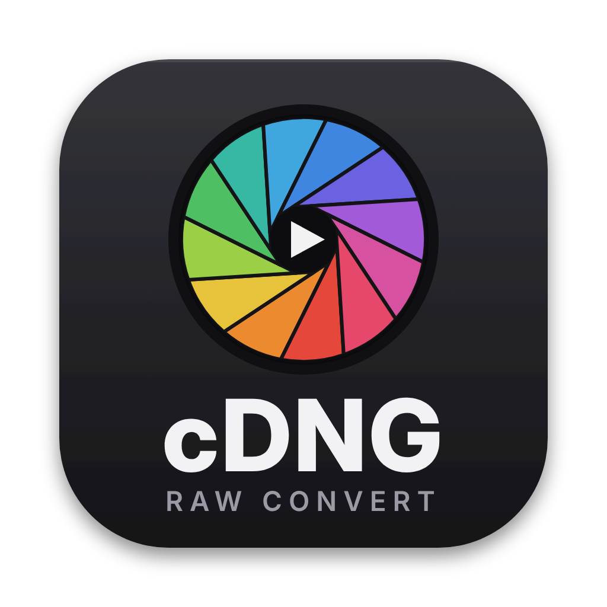

<p align="center">
  
</p>

<h1 align="center">cDNG Raw Convert</h1>

<p align="center">
  <a href="https://github.com/robobarius/cdng-raw-convert/actions/workflows/ci.yml"></a>
  <a href="https://github.com/robobarius/cdng-raw-convert/releases"></a>
  <a href="NOTICE.md"></a>
</p>

**Version 0.6.11, proof of concept.** SIGMA fp CinemaDNG to Apple ProRes RAW, Blackmagic RAW (beta) and compressed CinemaDNG, for the [fpSup](https://ijigen.github.io/fpSup/) community.

**cDNG Raw Convert** converts a **SIGMA fp CinemaDNG clip** (a folder of DNG frames plus its WAV) into **one Apple ProRes RAW `.mov`**, with the audio, timecode, metadata and fpSup Gyro2 gyro data inside. DaVinci Resolve opens the file natively as ProRes RAW, with working Camera Raw controls for ISO, white balance and exposure. Since 0.4, it can instead make **one Blackmagic RAW `.braw`** per clip, with the audio, timecode and (new in 0.5) gyro data inside. It can also re-compress a clip as **compressed CinemaDNG**, in slimRAW-style lossless and lossy modes.

It comes as a macOS app, plus a command-line encoder called `dng2prr` (macOS and Linux) and a Python version with a small window app for Windows and Linux.

<p align="center">
  
</p>

> **Experimental and community-built.** These are **not Apple's or Blackmagic Design's encoders**, and they are not licensed, certified or endorsed by Apple or Blackmagic Design. The Blackmagic RAW encoder (`dng2braw`, from the fpSup dng2braw project) was built by black-box testing against Blackmagic's decoder and Video Assist recordings. The format was worked out from FFmpeg's open-source ProRes RAW decoder, and Apple's behaviour was calibrated by measuring DaVinci Resolve with test patterns. It has been tested only in **DaVinci Resolve Studio 21.1.1 on macOS**. **Keep your original DNGs.**

> **Want to help port it to Windows or Linux?** Start with **PORTING.md**.

Apple and ProRes are trademarks of Apple Inc. Blackmagic RAW is a trademark of Blackmagic Design Pty. Ltd. SIGMA is a trademark of SIGMA Corporation. This project is not affiliated with either company.

## Download and install (macOS)

1. Go to the [latest release](https://github.com/robobarius/cdng-raw-convert/releases/latest) and download `cDNG-Raw-Convert-<version>-macOS.zip` (under *Assets*).
2. Unzip it and drag **cDNG Raw Convert.app** to your Applications folder.
3. **The first time, right-click the app and choose Open**, then Open again. The app isn't notarised by Apple (it's ad-hoc signed), so a plain double-click is blocked the first time. If macOS says the app "is damaged", run `xattr -dr com.apple.quarantine "/Applications/cDNG Raw Convert.app"` in Terminal.

Needs macOS 12 or later on an Apple silicon Mac (the released app is built for Apple silicon only; the command-line encoders inside it are universal). Blackmagic RAW playback in the viewer needs Blackmagic's free Blackmagic RAW software (Blackmagic RAW Player, the SDK, or DaVinci Resolve) installed.

**Linux and Windows:** the command-line encoder and the Python version build from source; see "Option B" and "Option C" below.

**Build it yourself, or contribute:** see [CONTRIBUTING.md](CONTRIBUTING.md). Report bugs and ideas under [Issues](https://github.com/robobarius/cdng-raw-convert/issues).

## What you get

- **One file per clip** instead of hundreds of DNGs. A 14-bit 4K test clip went from 11 GB of DNGs to about 6 GB at the default near-lossless setting. The "Standard" setting uses the same compression level as an Atomos Ninja V "ProRes RAW HQ" recording.
- **Native in Resolve:** the clip appears as "Apple ProRes RAW" with its audio. Camera Raw shows ISO, captured temperature and exposure bias, taken from each clip's EXIF.
- **Accuracy:**
  - Decoded values are linear, and neutrals stay neutral under daylight and tungsten white balance.
  - On a ColorChecker under tungsten, with grey-card white balance, the mean ΔE2000 is 4.5, and the neutral patches score 1.0–1.8.
- **Round trip:** at the default setting, decoding with FFmpeg gives an RMS error of 0.04 DN in the shadows and 0.6 DN in the highlights on 12-bit modes. That is far below sensor noise. See FINDINGS.md finding 9.
- **Built like a real Ninja V recording of the fp:** levels, metadata and the per-temperature white-balance tables follow what an Atomos Ninja V writes for this camera. See FINDINGS.md finding 10.
- **Tested modes:** FHD, 4K UHD, OG2K and OG3K (open gate), at 12-bit and 14-bit.

## Option A: the macOS app

`cDNG Raw Convert.app` is a native app: **no Python is needed**, and it runs on macOS 12 (Monterey) or later. Build it with `build/macos-app/Build cDNG Raw Convert.command` (see "Building the app" below); it's placed in the `macOS` folder. Earlier test builds were called "fp DNG to ProRes RAW", "DNG Raw Converter" and "DNG Raw Convert". The "c" stands for CinemaDNG: it works on video clips, not still photos.

It has three output formats:
- **Apple ProRes RAW:** one .mov per clip, with the audio inside.
- **Blackmagic RAW:** one .braw per clip, with the audio inside (see "Blackmagic RAW" below).
- **Compressed CinemaDNG:** the clip stays a folder of DNG frames, re-compressed with slimRAW-style modes. Every DNG tag is kept, and the WAV and other files can be copied along (see "Compressed CinemaDNG" below).

The app is one dark page in the style of a colour-grading suite. Every panel border can be dragged to resize it, and the sizes are remembered. When the window is made smaller, the side panels shrink to fit, so nothing is cut off.

- **Media Storage** (top left):
  - Browses your volumes and SD cards (they appear when mounted) plus Desktop, Movies, Documents and Downloads.
  - Clip folders (folders of DNG frames) are marked with an orange film icon, and `.braw` and `.mov` files are listed too. Each clip shows its mode, frame rate, length and a GYRO badge.
  - **Click a clip to view it**: no importing. ⌘-click and ⇧-click select several.
  - **Add to Queue** (or double-click a clip) puts the selected clips in the Job Queue. With a folder, card or drive selected, it adds every clip inside it. ⌘I also adds clips from a file dialog, and clips dropped on the window go into the queue.
- **Job Queue** (below it): each job with its output, settings and progress. Click, ⌘-click or ⇧-click to select jobs; drag them to change the order (jobs render top to bottom); press Delete, or use the right-click menu, to remove the selected jobs. The menu also moves them up, down, to the top or to the bottom.
- **Add to Queue** in the Output panel does the same as the one in Media Storage, with the Output panel's current settings.
- **Viewer** (centre):
  - Plays **CinemaDNG** clips (the bundled `dng_view` helper, see below), **Blackmagic RAW** `.braw` files (through Blackmagic's own decoder, see below) and **ProRes RAW / ProRes / H.264** `.mov` files (AVFoundation), with their sound and timecode.
  - Playback resolution: **Full**, **Half** (default) or **Quarter**. Playback follows the display's refresh: it waits for a short buffer, then shows each frame when it's due. Frames between refreshes are skipped on purpose (a 100 fps clip on a 60 Hz screen), and "dropping frames" appears only when a frame isn't ready in time.
  - **Decode** menu (the first one in the viewer's header): how raw frames (DNG and BRAW) are shown.
    - **709** (Rec.709): for viewing. Highlights roll off smoothly up to the sensor's clip, so nothing below it is cut off, and clipped areas go to white instead of magenta.
    - **Film** (Blackmagic Film Gen 5, Blackmagic Wide Gamut): flat, with the whole range. Use it with LUTs made for Blackmagic Film Gen 5, such as Blackmagic's own camera LUTs.
    - **Lin 709 / Lin 2020** (scene-linear, Rec.709 or Rec.2020 primaries, middle grey at 0.18): for LUTs that expect linear input. The LUT gets real linear values, highlights above 1.0 included, but a LUT only sees what its own input range covers (most linear LUTs stop at 1.0).
    - `.mov` files play as macOS renders them.
  - **LUT** menu: monitoring LUTs (viewer only), applied after the Decode step. Your own `.cube` files, or the built-in False Color.
  - **Squeeze** menu: anamorphic de-squeeze (1.25, 1.33, 1.5, 1.6, 1.66, 1.8 or 2.0x). Like the LUT, it stays set from clip to clip, and it's what the output writes. While it's None, Blackmagic RAW files shot anamorphic use their own factor.
  - **Zoom**, as in Resolve: scroll (or pinch) on the picture to zoom around the pointer, drag to pan, **Z** to fit. The zoom menu has Fit and 25, 50, 100, 200 and 400 % of the source frame. For a sharp picture above 50 %, set playback to **Full**.
  - **Histogram** button: a floating palette (luma and the R, G and B channels, each switchable). Drag it anywhere and resize it; it remembers where it was.
  - Clicking or dragging on the scrubber while playing jumps there and keeps playing, for spot-checking a clip.
  - Keys: space play/pause, ← → one frame, ↑ ↓ first/last frame. They work from anywhere in the window except while you're typing in a text field. Click anywhere else to leave the field.
- **Right panel**, with two tabs:
  - **Output:** the three formats in order (1. CinemaDNG Compress, 2. Blackmagic RAW, 3. Apple ProRes RAW), then folding sections for the chosen one. **Embedded Data** includes **Anamorphic de-squeeze**: the clip's Squeeze factor is written into `.braw` and `.mov` files as their pixel aspect, and Resolve de-squeezes them (checked in Resolve 21: PAR 1.6 and 2.0).
  - **Metadata:** everything about the selected clip:
    - DNG clips: camera, serial number, firmware, exposure, white balance, image and crop, DNG version and compression, audio, gyro, BRAW support, size on disk.
    - `.braw` files: every clip metadata entry.
    - `.mov` files: tracks, codec, data rate and metadata.
- **Log** (under the viewer): the encoders' full output. **Copy** puts it on the clipboard.

**CinemaDNG playback** uses `dng_view`, a small helper built with the app from the fpSup DNG reader (the one the encoders use). It reads uncompressed and compressed DNGs (lossless and lossy) on every core and develops them for monitoring: the DNG's own levels, white balance and colour matrices, the default crop, a quick debayer, and a display curve. It's for judging framing, focus and exposure, not a grade; the converted files are untouched by it. Without the helper, the viewer falls back to macOS's RAW engine, which manages about 25–35 fps on fp frames.

**Blackmagic RAW playback** uses a small helper (`braw_view`) built against Blackmagic's free Blackmagic RAW SDK when the SDK is installed at build time. It loads Blackmagic RAW at run time from the Blackmagic RAW SDK, Blackmagic RAW Player or DaVinci Resolve. Nothing of Blackmagic's is copied into the app. Without them, `.braw` clips show a message instead of a picture.
  - Since 0.6.8 it decodes on the GPU with the SDK's Metal pipeline, as DaVinci Resolve and Blackmagic RAW Player do (on the CPU when there's no Metal; `braw_view --cpu` forces it). On an M1 Max, full-resolution 6K decodes at about 100 fps instead of 24–28 fps.
  - Frames reach the app through shared memory rather than the pipe (a full-resolution 6K frame is 77–98 MB), into IOSurfaces the viewer shows directly. The monitoring LUT runs on the GPU too.
  - M1 Max, Full resolution, with a monitoring LUT: Pocket 6K Pro (6048×3200) and Cinema Camera 6K (6048×4032) 23.976/24 fps clips play with every frame on time (0.6.7: about 1 frame in 8 on time, then stalls). Checked over 40 s of playback with flat memory, since 0.6.9.

**Compressed CinemaDNG folder names** (next to each clip) end in `_lossless`, `_lossless-10log`, `_vbr-hq`, `_vbr-lt`, `_lossy3-1`, `_lossy4-1`, `_lossy5-1` or `_lossy7-1`. Folders with these endings, or the older upper-case ones, are skipped when a folder is added to the queue, but you can view or add one by selecting it directly.

**Blackmagic RAW: how it opens.** In the Output panel, **Opens as** sets what Resolve and Blackmagic RAW Player show by default: **Film Gen 5** (flat: Blackmagic Film Gen 5 gamma, Blackmagic Wide Gamut, colour science generation 5, as Blackmagic cameras shooting Film) or **Rec.709** (as the Video Assist's files). The picture data is the same either way; it can always be changed in Resolve's Camera RAW settings.

**How files are written:**
- Each clip becomes `<clip name>.mov`, with its WAV inside.
- A clip is written to a hidden temporary file and renamed only once it's complete. So stopping, or a failure, never leaves a half-written .mov.
- If the destination is read-only, output goes to `~/Movies/cDNG Raw Convert`.

**First launch:** the app isn't notarised by Apple, so macOS blocks it the first time. Right-click the app → **Open** → **Open**. If that doesn't work, go to System Settings → Privacy & Security and click "Open Anyway".

**Building the app:** double-click `build/macos-app/Build cDNG Raw Convert.command`. It needs only Apple's command-line tools (`xcode-select --install`), and puts the app in `macOS/`.

The older drag-and-drop droplet, which needs Python, is still in `build/macos/`.

## Blackmagic RAW

The `.braw` output is made by the bundled `dng2braw` encoder (sources in `source/braw/`; its findings are in the fpSup dng2braw project's FINDINGS.md).

- **Real Blackmagic RAW**, decoded by Blackmagic's own SDK and by DaVinci Resolve, laid out like a Blackmagic Video Assist 12G recording of the fp: same slice layout, metadata keys, timecode track and sound track.
- **Compression:** 3:1 to 12:1 constant bitrate (every frame fits that fraction of the 12-bit size) or Q0 to Q5 constant quality.
- **Colour:** fitted to the Video Assist's recordings of the same scenes; converted clips render within about 1 % of them in Resolve. The as-shot white balance is written as Blackmagic's kelvin and tint (for example 3286 K, +8 where the Video Assist wrote 3282 K, +9).
- **Audio:** the clip's WAV, as 24-bit PCM in one-second chunks, as the Video Assist writes it. Decoded, it is bit-identical to the WAV.
- **Gyro** (new in 0.5): fpSup Gyro2 data is written as Blackmagic motion data (gyroscope and accelerometer tracks, as a Blackmagic camera writes them), plus the same Gyroflow Protobuf track the `.mov` gets.
  - Gyroflow and its OpenFX plugin (Gyroflow 1.6.3's parser) read a `.braw` only through its Blackmagic reader, and that's what reads this data. Its readings match the `.mov` route's, with no time offset.
  - In this route Gyroflow doesn't get fpSup's per-frame lens fit. Load a lens profile in the plugin.
  - **Beta.** If you re-render a .braw that the Gyroflow plugin has already loaded in Resolve, quit and reopen Resolve: the plugin keeps a file's gyro data, by name, until Resolve quits (FINDINGS 15).
  - The Blackmagic RAW SDK also reports the motion data. Whether Resolve's own gyro stabilisation accepts it for a non-Blackmagic camera hasn't been tested yet.
- **Speed** on an M1 Max: about 70 fps at 5:1 with the GPU, about 33 fps on the CPU only.
- **Limits:**
  - fp UHD (3840×2160) and open gate OG3K (3008×2000, new in 0.5) clips so far; other modes are reported as "not supported yet" and skipped;
  - the colour fit was made at 3200 K, ISO 800;
  - tested in DaVinci Resolve Studio 21 on macOS only.

## What a ProRes RAW conversion carries

These apply to the native encoder (the app and `dng2prr`); the Python version writes picture, audio and camera metadata only.

| | How it's stored in the .mov | Checked |
|---|---|---|
| **Picture** | ProRes RAW frames (`aprh`/`aprn`) | Resolve |
| **Audio** | The clip's WAV as PCM, sample-accurate to the picture length | Resolve |
| **Timecode** | The first frame's DNG TimeCodes tag becomes a QuickTime timecode track (drop-frame flag kept) | Resolve shows the same Start TC as the DNGs |
| **Camera metadata** | ISO, white balance, shutter, aperture, lens, colour calibration tables, as a Ninja V writes them | Resolve's Camera Raw panel |
| **fpSup Gyro2 gyro data** | Converted to Gyroflow's own format (Gyroflow Protobuf) and stored as a telemetry track (`gyrf`, handler `GyroflowTelemetry`): one message per frame with that frame's gyro and accelerometer samples, timing, exposure, ISO, crop and lens data. Stock Gyroflow and the Gyroflow OpenFX plugin read this from the .mov directly | Decodes with Gyroflow's schema; same messages as the fpSup plugin builds from the DNGs; Resolve plays the file |
| **Every frame's DNG tags** | A timed-metadata track (`mebx`, key `io.github.ijigen.fpsup.dng.frame-tags`): one sample per frame holding all of that frame's tags as a small TIFF without the image. That includes the EXIF MakerNote and any fpSup additions (gyro/lens telemetry, private tags) | Byte-identical tags after extraction |
| **SPP_metadata.xmp** | Movie metadata key `io.github.ijigen.fpsup.SPP_metadata.xmp` | |
| **Gyroflow files** (`.gcsv`, `.json`, `.jsonl`, `.gyroflow`, `.GYR` in the clip folder) | Copied next to the .mov and named after it (`B001_013.gcsv`…), so Gyroflow finds them automatically | |

**Getting per-frame metadata back:** `dng2prr --extract-meta CLIP.mov OUTDIR` writes each frame's tags as `OUTDIR/000000.tif`, `000001.tif`, … Tools that read per-frame data from DNG headers can read these files instead.

**Gyro data (fpSup Gyro2):** when every DNG of a clip carries a Gyro2 block, the .mov gets a Gyroflow telemetry track. It's built with the same arithmetic as the Gyroflow (fpSup) plugin uses on the DNG sequence: Vd-based frame timing, sample de-duplication, the accelerometer turned into the gyro's axes, and, for lenses with electronic contacts, the camera's own distortion data fitted per frame. So open the .mov in Gyroflow, or apply the Gyroflow OpenFX plugin to it in Resolve, without a sidecar. The raw blocks also stay in the per-frame tags.
- `--gyro-jsonl` also writes the same data as `CLIP.jsonl` (Gyroflow's text form of the format). Gyroflow only reads a `.jsonl` next to a video that has no telemetry of its own, so this is for when the .mov is later transcoded to something that drops the track.
- `--no-gyro` leaves the track out. Clips where only some frames have Gyro2 data get no track, with a warning.
- Compressed CinemaDNG output keeps the MakerNote, so the Gyro2 data survives re-compression too. Since 0.6.10 that includes fpSup Gyro2 v0.2.0 and later (block version 2 in its own MakerNote entry, read by the Gyroflow (fpSup) plugin v0.1.10), whose position the writer moves with the MakerNote. `tests/verify_gyro2.py CLIP_FOLDER [ORIGINAL_FOLDER]` checks a clip the way the plugin reads it.

## Compressed CinemaDNG

Each DNG is rewritten with its image stored as compressed tiles (256×256), the way DNG converters do it.

**What's kept:**
- Every other tag is copied unchanged: colour matrices, white balance, EXIF, timecode, lens corrections and Sigma's private data.
- The folder structure below the source folder is mirrored in the destination.
- Frame file names don't change.

| Mode | What it does | Typical size (12-bit fp) |
|---|---|---|
| Lossless | Lossless JPEG, the standard DNG compression. **Bit-exact.** | 2.4–2.7:1 (14-bit: about 1.4:1) |
| Lossless 10-bit log | Stores 10-bit codes on a curve whose steps stay below the sensor's noise (1 DN steps near black). A LinearizationTable maps them back. Visually lossless. | 2.5–3:1 (14-bit: about 2.1:1) |
| Lossy VBR HQ / LT | 12-bit DCT JPEG on square-root-coded data, constant quality | HQ 3.4–3.9:1, LT 5–6.7:1 |
| Lossy 3:1, 4:1, 5:1, 7:1 | The same, with the quality adjusted per frame to hit the ratio (within about 4%, against the uncompressed image) | as named |

**Checked so far:**
- **Lossless round trip:** decoding a lossless file gives exactly the original values.
- **Verification pass:** with it on, every tile is decoded again and checked before the file is written.
- **Resolve 21.1.1 on macOS:** it opens every mode.
  - **Lossless** renders the same as the original DNG. The only differences are in the outermost row or two of the picture, at the level of Resolve's 10-bit still-export rounding.
  - **Lossy modes** keep the average brightness within 0.7%. Measured on a dark tungsten frame, the difference from the original is roughly 37 dB (VBR HQ) and 31 dB (7:1) PSNR, on a square-root (gamma 2) scale.
- **Other apps:** lossy CinemaDNG is less widely supported than lossless, so check your other software before relying on it.

**Compared with slimRAW:** the modes are named after slimRAW's, but this is an independent implementation. Sizes and quality won't match slimRAW exactly, and slimRAW's "Premiere compatibility" and "Downscale 2X" options aren't available.

## Option B: Linux and Windows (experimental)

| Platform | Status |
|---|---|
| **Linux** | Works from the command line (native `dng2prr` or Python) and with a small window app. **Not yet checked** in Resolve on Linux. |
| **Windows** | Prepared but **not yet run on a real PC**. |

Build scripts and instructions are in `build/linux` and `build/windows`; see PORTING.md. Once built, open the window app:

```bash
python3 source/dng2prr_gui.py
```

## Option C: command line (any platform)

```bash
# native encoder, no Python needed (macOS or Linux):
cc -O2 -ffp-contract=off -o dng2prr source/dng2prr_cli.c source/prr_core.c source/dng_lj92.c source/dng_jpeg.c source/fsg2.c -lm -lpthread
./dng2prr OUT.mov /path/to/CLIP_FOLDER          # picks up the WAV in the folder
# on a Mac, add the GPU stages (as the app's build does):
#   ... source/fsg2.c -DFP_METAL -fno-objc-arc source/fp_metal.m -framework Metal -framework Foundation -lm

# Blackmagic RAW instead (bundled in the app as Contents/MacOS/dng2braw; build it from source/braw):
#   dng2braw OUT.braw CLIP_FOLDER [--ratio 3|5|8|12 | --quality Q0..Q5] [--neutral R/G,B/G] [--cpu]
# compressed CinemaDNG instead (writes the clip's DNGs, re-compressed, into OUT_FOLDER):
./dng2prr --cdng OUT_FOLDER /path/to/CLIP_FOLDER --cdng-mode lossless --copy-other --verify
#   modes: lossless, log10, vbr-hq, vbr-lt, 3, 4, 5, 7

# or the Python version (ProRes RAW only; needs numpy; build/linux/build.sh builds both):
python3 source/dng2prr.py OUT.mov /path/to/CLIP_FOLDER
```

The two versions write identical files (`tests/compare_native.py` checks this). The native one is about 2–3× faster. A Metal build's GPU path rounds its DCT slightly differently, so its ProRes RAW differs from them by rounding only (mean 0.009 of an 8-bit level on the test clip); with `--cpu` it is identical. Lossless CinemaDNG is bit-exact either way.

**GPU (macOS, new in 0.6.7).** With Metal, all three outputs use the GPU for their transform stages: the ProRes RAW curve, DCT and quantisation; the lossy CinemaDNG DCT, quantisation and rate-control statistics; the lossless CinemaDNG predictor. The entropy coding (ProRes RAW codebooks, JPEG Huffman) stays on the CPU, on every core: it's sequential, bit-by-bit work that GPUs are bad at. `--cpu` (or `DNG2PRR_CPU=1`) turns the GPU off. On an M1 Max, 129 UHD frames (warm cache):

| Output | 0.6.6 | 0.6.7 GPU |
|---|---|---|
| ProRes RAW (near-lossless) | ~35 fps | ~54 fps |
| CinemaDNG lossless | 35 fps | 103 fps |
| CinemaDNG VBR-HQ | 42 fps | 85 fps |
| CinemaDNG 7:1 | 17 fps | 67 fps |
| Blackmagic RAW 5:1 (already GPU) | ~70 fps | ~70 fps |

`--verify` decodes every written DNG again and costs some of that speed. From a slow drive the drive is usually the limit.

| Option | What it does |
|---|---|
| `--scale N` | Quality. 1 = near-lossless (default), 2 = high, 4 = standard (same compression level as a Ninja V "HQ" recording), 8 = compact. |
| `--neutral R/G,B/G` | Overrides white balance with values measured from a grey card, e.g. `0.737,0.367` |
| `--gain G` | Exposure gain. The default is 2^BaselineExposure from the DNG. |
| `--jobs N` | Number of frames encoded in parallel. The default is all cores. |
| `--cpu` | Don't use the GPU (Metal builds only) |
| `--cache DIR` | Saves each finished frame, so an interrupted encode can resume (Python version only) |
| `--fps`, `--limit`, `--wav` | Override the frame rate, encode only the first N frames, choose the audio file |
| `--list-clips PATH…` | Lists the clip folders found under the given paths |
| `--no-gyro`, `--gyro-jsonl` | Leave out the Gyroflow telemetry track; also write it as `OUT.jsonl` (native only) |
| `--no-extra` | No timecode, per-frame metadata or gyro tracks (native only) |

## Working with the files in Resolve

- **To adjust ISO, white balance or exposure:** set **Decode Using → Clip** in the Camera Raw tab.
- **It looks darker and flatter than the DNG.** ProRes RAW decodes scene-linear, while Resolve applies each DNG's built-in tone curve and baseline exposure. Grade with exposure, or a log transform, as you would footage from any ProRes RAW camera.
- **RAW to Log** can only be selected in non-colour-managed (DaVinci YRGB) projects.

## Version notes

See CHANGELOG.md. Files made with High, Standard or Compact quality **before 0.1** have a magenta tint and should be re-converted.

## Known issues and limitations

- **The fp can record the wrong as-shot white balance.**
  - In a tungsten test with custom white balance set in camera, the DNGs recorded R/G 0.911, B/G 0.719.
  - The grey target, the chart's neutral patches and a sheet of paper all measured 0.737 / 0.367.
  - Footage then looks green in both DNG and ProRes RAW. Use `--neutral` (or the app's white-balance setting) with values from a grey card.
  - This is worth checking on the firmware side. See FINDINGS.md.
- **Lens corrections from the DNG (OpcodeList3)** aren't applied to the picture. They're carried in the per-frame tags, and Gyroflow gets the distortion through the gyro track.
- **Gyro track:** checked against Gyroflow's schema and the fpSup plugin's algorithm, but not yet in Gyroflow itself. Please report whether Gyroflow and the OpenFX plugin pick it up and stabilise correctly. Tested with a manual lens (no focal length in the DNGs), so the per-frame lens fit hasn't been tried on a real clip.
- **Not tested** in Final Cut Pro, Premiere or Assimilate, or in Resolve on Windows or Linux.
- **Compressed DNGs as input:** both lossless and lossy compressed DNGs can be read, including the fp's own lossless mode (checked on a 2026-10-25 clip: first frame uncompressed, the rest lossless JPEG in 512×512 tiles) and lossy DNGs another tool made from a Ninja V recording.
- **The white-balance tables** are new in 0.3. If changing the Color Temp in Resolve's Camera Raw panel behaves oddly on a converted clip, please report it.
- **The calibration is empirical.** A later Resolve or Apple update could change how these files decode.
- **Folders of stills** at different resolutions are rejected, because they aren't a single clip.

## Files

```
README.md          this file
CHANGELOG.md       version history
FINDINGS.md        technical findings: format details, Apple decoder behaviour, test results
PORTING.md         handoff guide for Windows/Linux ports and further development
LICENSE            GPL-3.0 (the licence of the project as a whole; see NOTICE.md)
NOTICE.md          which files are LGPL-2.1-or-later and which GPL-3.0-or-later; third-party code; trademarks
LICENSES/          the full GPL-3.0 and LGPL-2.1 texts
CONTRIBUTING.md    how to build, test and contribute
.github/           issue forms, pull-request template, and the build-and-test workflow (GitHub Actions)
macOS/             cDNG Raw Convert.app, once built (native app, macOS 12+; build it with build/macos-app)
source/
  dng2prr_cli.c    native command-line encoder (C; same output as dng2prr.py)
  dng2prr.py       Python version: DNG reader, level mapping, frame header, QuickTime writer, command line
  prr_core.c       tile and entropy encoder (DCT + ProRes RAW coding)
  fp_metal.h/.m    Metal (GPU) versions of the transform stages of all three outputs (macOS)
  dng_lj92.c       lossless-JPEG decoder for compressed DNGs
  dng_jpeg.c       JPEG codecs for compressed DNG output: lossless encoder, 12-bit lossy encoder/decoder
  fsg2.c, fsg2.h   fpSup Gyro2 data -> Gyroflow Protobuf (port of the fpSup Gyroflow plugin's decoder, v0.1.10)
  dng2prr_gui.py   cross-platform window (Tkinter) for Windows/Linux
  braw/            the Blackmagic RAW encoder dng2braw (C + Metal), from the fpSup dng2braw project; its findings (1–45) in braw/FINDINGS.md
build/
  macos-app/       the native macOS app (SwiftUI source, icon + make_icon.py, "Build cDNG Raw Convert.command")
  macos/           the older drag-and-drop droplet (needs Python)
  linux/build.sh   compile + self-test (+ optional menu entry)
  windows/         build.bat (compile + self-test), build_exe.bat (standalone .exe via PyInstaller)
tests/
  selftest.py      byte-level check of a build against reference.json (no camera files needed)
  test_lj92.py     round-trip tests for the lossless-JPEG decoder
  compare_native.py  checks the native encoder writes the same file as dng2prr.py
  test_fsg2.c      Gyro2 conversion tests (the plugin's golden values)
  check_gyro.py    decodes a .mov's gyro track with gyroflow.proto and checks it (needs pip protobuf)
  gyroflow.proto   Gyroflow Protobuf schema, from telemetry-parser (MIT/Apache-2.0)
  validation/      clips + scripts to check a build in Resolve (or another Apple-based decoder)
```

## Credits

- The ProRes RAW bitstream was reverse-engineered by the FFmpeg developers (Paul B Mahol, Lynne and others) in FFmpeg's `libavcodec/prores_raw.c`. This encoder's codebook tables come from that work.
- The Gyro2 conversion is a port of ijigen's Gyroflow (fpSup) plugin code (`common/src/fsg2.rs`, `lensfit.rs`); the Gyroflow Protobuf schema is AdrianEddy's telemetry-parser.
- Built for the fpSup community.

## Licence

**GPL-3.0-or-later** for the project as a whole: see [LICENSE](LICENSE) and [NOTICE.md](NOTICE.md).

Most source files are LGPL-2.1-or-later and say so in their headers. `source/fsg2.c` (and its copy in `source/braw/`) is GPL-3.0-or-later, because it's a translation of GPL-3.0 code from ijigen/gyroflow-plugins. So the `dng2prr` and `dng2braw` binaries and the macOS app, which include it, are GPL-3.0-or-later. `libprr` and the Python version don't use it and stay LGPL. To build without it, leave `fsg2.c` out and compile with `-DNO_GYRO`.
